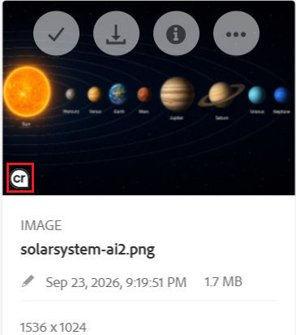
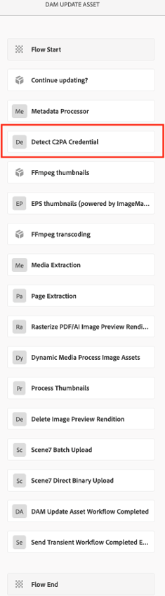

# C2PA metadata in [!DNL Experience Manager Assets] {#c2pa-metadata}

Brands are more concerned than ever about content transparency, AI disclosure, and preventing the tampering of assets. The Content Authenticity Initiative (CAI) at Adobe builds tools compliant with the [Coalition for Content Provenance and Authenticity](https://c2pa.org/specifications/specifications/2.2/specs/C2PA_Specification.html) (C2PA) technical standard. C2PA metadata, a new kind of tamper-evident metadata, help viewers understand the lineage of content and ensure the integrity of brand assets. They can include a wide range of provenance data that offer insight into the history of a digital asset.

This information includes:

* **Issuer or Signer:** Information about the entity or company that issued the digital signature for the asset.
* **Issue Date:** The date on which the C2PA metadata was applied to the asset.
* **Process:** Records of any edits or modifications made to the asset.
* **Device Details:** Information about the app or device used to create or edit the asset.
* **AI Tool Used:** If generative AI was used to edit or create the asset, the name of the model used is included.
* **Other Pertinent Information:** Additional data that offers more context about the history of an asset.

For more information about an asset's history, see [Verify](https://contentcredentials.org/verify).

[!DNL Adobe Experience Manager Assets] detects C2PA metadata when you upload or update an asset, flags those assets in the [!DNL Assets] user interface, and keeps Gen AI disclosure intact on the renditions that [!DNL Experience Manager] generates. Whenever [!DNL Experience Manager] creates or modifies a rendition of a Gen AI asset, such as a thumbnail, a web rendition, a watermarked copy, or a video transcode, [!DNL Experience Manager] signs that rendition with a new C2PA metadata that references the original asset as its parent. Renditions that you download, publish, or share keep their provenance.

## Prerequisites {#Prerequisites}

C2PA metadata support requires [!DNL Adobe Experience Manager] 6.5 Service Pack 6.5.26.0 or later. On Service Pack 6.5.25.0, install the [AEM 6.5 SP25 – C2PA GenAI compliance hotfix](https://experience.adobe.com/#/downloads/content/software-distribution/en/aem.html?package=/content/software-distribution/en/details.html/content/dam/aem/public/adobe/packages/cq650/hotfix/cq-6.5.0-hotfix-ASSETS-75868-SP25-1.0.zip) instead.

## View C2PA metadata in the [!DNL Assets] user interface {#view-c2pa-metadata}

Assets that carry C2PA metadata display the **cr** (C2PA metadata) badge in the [!DNL Assets] user interface. Navigate to **[!UICONTROL Assets]** > **[!UICONTROL Files]** and look for the badge in the lower-left corner of:

* The asset thumbnail in **[!UICONTROL Card View]**.
* The asset thumbnail in **[!UICONTROL Column View]**. Select the asset to show its thumbnail.
* The preview area of the asset details page.

The **cr** badge shown in the following figure indicates whether an asset contains C2PA metadata. It does not show the manifest itself. To view the complete manifest, download the asset, and open it in [Verify](https://contentcredentials.org/verify).



[!DNL Experience Manager] stores the detected manifest as a `c2pa-manifest.json` rendition on the asset. This rendition is internal. It does not appear in the **[!UICONTROL Renditions]** panel of the asset details page or in the rendition picker.

## How C2PA metadata works {#how-c2pa-metadata-works}

C2PA metadata support has two parts: detection when an asset is uploaded or updated, and re-signing whenever [!DNL Experience Manager] generates or modifies a rendition.

### Detect C2PA metadata {#detect}

The **[!UICONTROL DAM Update Asset]** workflow includes a **[!UICONTROL Detect C2PA Credential]** step which runs after the **[!UICONTROL Metadata Processor]** step as shown in the figure below. It reads the original binary of the asset and records the result in the asset's metadata node `jcr:content/metadata`.

 

The following table lists the key metadata properties in the C2PA metadata workflow.

| Property | Type | Description |
|---|---|---|
| `dam:hasC2PAManifest` | `boolean` | `true`, if the original binary has an embedded C2PA manifest. It is always written. |
| `dam:isAiGenerated` | `boolean` | `true`, if the manifest puts the asset in scope for Gen AI labeling. It is written only when a manifest is present. |
| `dam:c2paValidationState` | `string` | It describes the validation state of the manifest: `TRUSTED`, `VALID`, `INVALID`, or `UNKNOWN`. It is written only when a manifest is present. |

When a manifest is present, [!DNL Experience Manager] also stores it as the `c2pa-manifest.json` rendition (`application/json`).

If you replace the original asset with a binary that has no manifest, the next workflow run sets `dam:hasC2PAManifest` to `false` and removes `dam:isAiGenerated`, `dam:c2paValidationState`, and the `c2pa-manifest.json` rendition.

>[!NOTE]
>
>A detection failure never blocks an asset ingestion. If reading the manifest times out or fails, [!DNL Experience Manager] logs the error, leaves the metadata unchanged, and continues with the rest of the workflow.

### Sign renditions {#sign-renditions}

A rendition is a new binary, so the manifest embedded in the original asset does not cover it. To keep Gen AI disclosure intact, [!DNL Experience Manager] signs every eligible rendition as the last step of the process that produces it. The new C2PA metadata:

* References the original asset as its **parent** ingredient.
* Records how the rendition was derived from the original asset, as one of the C2PA actions `c2pa.resized`, `c2pa.transcoded`, or `c2pa.edited`.
* Names `Adobe Experience Manager` as the software agent.

[!DNL Experience Manager] signs a rendition only when all of the following are `true`:

* The source asset has `dam:isAiGenerated` set to `true`. Assets that carry a manifest but are not generated through AI still shows the **cr** badge, but [!DNL Experience Manager] does not re-sign their renditions.
* The source manifest is readable and its validation state is not `INVALID`. [!DNL Experience Manager] never chains a new signature onto a manifest that failed validation, for example, after the asset was tampered.
* The rendition format supports an embedded C2PA manifest. For more information, see [Supported formats](#supported-formats). [!DNL Experience Manager] skips the unsupported formats without an error.

The following steps of the **[!UICONTROL DAM Update Asset Workflow Completed]** workflow shown in [Detect C2PA metadata](#detect) sign their output.

| Workflow step | Renditions signed | C2PA action recorded |
|---|---|---|
| **[!UICONTROL Process thumbnails]** | Thumbnail renditions and the web-enabled image. | `c2pa.resized` and `c2pa.transcoded` when the format changes. |
| **[!UICONTROL EPS thumbnails (powered by ImageMagick)]** | Primary output, derived thumbnails, and web renditions. | `c2pa.resized`, `c2pa.transcoded`, or `c2pa.edited` |
| **[!UICONTROL FFmpeg thumbnails]** | Video poster frames and thumbnails. | `c2pa.resized` and `c2pa.transcoded` |
| **[!UICONTROL FFmpeg transcoding]** | Video encodings. | `c2pa.transcoded` |
| **[!UICONTROL Rasterize PDF/AI Image Preview Rendition]** | Preview rendition. (`cqdam.preview.png`) | `c2pa.transcoded` |

The following workflow processes also sign their output when you use them in the **[!UICONTROL DAM Update Asset Workflow Completed]** workflow, in another workflow, or in a custom workflow model. Select them in the **[!UICONTROL Process Thumbnails]** list of a workflow step as shown in [Detect C2PA metadata](#detect).

| Workflow process | Renditions signed | C2PA action recorded |
|---|---|---|
| **[!UICONTROL Create Thumbnail]** | Thumbnail renditions. | `c2pa.resized` and `c2pa.transcoded` when the format changes. |
| **[!UICONTROL Create Web Enabled Image]** | Web renditions. | `c2pa.resized` and `c2pa.transcoded` when the format changes. |
| **[!UICONTROL Command Line]**, for example, with [!DNL ImageMagick] | Primary output, derived thumbnails, and web renditions. | `c2pa.resized`, `c2pa.transcoded`, or `c2pa.edited` |
| **[!UICONTROL Image Watermarking Process]** | Watermarked rendition, or the original rendition when watermarking is in place. For more information, see [Watermark your assets](/help/assets/watermarking.md). | `c2pa.edited` |
| **[!UICONTROL Create Video Storyboard]** | Storyboard key frames. | `c2pa.transcoded` |
| **[!UICONTROL XMP Writeback]** | The original rendition, after the metadata is written back. For more information, see [XMP writeback to renditions](/help/assets/xmp-writeback.md). | `c2pa.edited` |

### Protect the original binary during XMP writeback {#xmp-writeback}

XMP writeback rewrites the original binary, which breaks its embedded manifest. For assets with `dam:hasC2PAManifest` set to `true`, [!DNL Experience Manager] changes the behavior of the **[!UICONTROL XMP Writeback Process]** step of the **[!UICONTROL DAM Metadata Writeback]** workflow as follows:

* **Gen AI assets** (`dam:isAiGenerated` is `true`): [!DNL Experience Manager] writes the XMP and then re-signs the original binary, with the pre-writeback binary as the parent. It saves the writeback and the new signature together. If re-signing fails, it discards both and fails the step.
* **Other assets that carry a manifest**: [!DNL Experience Manager] skips XMP writeback and logs the reason. The original binary and its manifest stay unchanged.

### Signing mode {#signing-mode}

[!DNL Experience Manager] signs renditions locally, on the instance that produces them, with an ephemeral, self-signed certificate that it generates itself. Signing needs no network access and no certificate or private key configuration.

>[!NOTE]
>
>You cannot configure your own signing certificate. Validators such as [Verify](https://contentcredentials.org/verify) show the rendition's Gen AI disclosure and the link to the original, but do not identify your organization as the signer.

## Configure C2PA metadata {#configure}

C2PA metadata support is enabled by default. You do not need to install or configure anything.

### OSGi configuration {#osgi-configuration}

To change the default configuration, configure the **[!UICONTROL Day CQ DAM C2PA Service]** (PID `com.day.cq.dam.core.impl.c2pa.C2PAServiceImpl`) in Configuration Manager at `https://[aem_server]:[port]/system/console/configMgr`as shown in the figure below, or add an OSGi configuration to your project. For more information, see [Configure OSGi](/help/sites-deploying/configuring-osgi.md).


The table below lists the properties in the OSGi configuration of your project.

| Property | Name in Configuration Manager | Default | Description |
|---|---|---|---|
| `enabled` | **[!UICONTROL Enabled]** | `true` | Turns the C2PA metadata support on or off. When turned off, [!DNL Experience Manager] does not detect manifests and does not sign renditions. |
| `timeoutMillis` | **[!UICONTROL CLI Timeout (ms)]** | `30000` | Specifies the maximum time, in milliseconds, that [!DNL Experience Manager] waits for a single read or signing operation on a file before treating it as timed out. Raise this value for large video or high-resolution image files. |

For example, add an OSGi configuration at `/apps/<your-project>/config/com.day.cq.dam.core.impl.c2pa.C2PAServiceImpl.config`.

```text
enabled=B"true"
timeoutMillis=L"60000"
```

### Turn off C2PA metadata support {#disable}

In the **[!UICONTROL Day CQ DAM C2PA Service]** configuration shown in [OSGi configuration](#osgi-configuration), disable the **[!UICONTROL Enabled]** option, and then save the changes. The change takes effect immediately without a restart:

* The **[!UICONTROL Detect C2PA Credential]** step shown in [Detect C2PA metadata](#detect) becomes non-operational.
* Workflow steps create renditions without signing them.
* Assets processed earlier keep their `dam:hasC2PAManifest` property and still show the **cr** badge.

>[!CAUTION]
>
>After disabling the **[!UICONTROL Enabled]** option, renditions of Gen AI assets carry no C2PA metadata. If you want to comply with the Gen AI disclosure regulations, enable the **[!UICONTROL Enabled]** option.

### Workflow configuration {#workflow}

The **[!UICONTROL Detect C2PA Credential]** step shown in [Detect C2PA metadata](#detect) is part of the default **[!UICONTROL DAM Update Asset]** workflow model. If you use a custom copy of that model, add the step yourself:

1. In the [!DNL Experience Manager] interface, navigate to **[!UICONTROL Tools]** > **[!UICONTROL Workflow]** > **[!UICONTROL Models]**, and open your model in  **[!UICONTROL Edit]** mode.
1. Add the **[!UICONTROL Detect C2PA Credential]** step after **[!UICONTROL Metadata Processor]**, before any step generates the renditions.
1. Select **[!UICONTROL Sync]** to save the model.

Rendition steps sign their output only if detection has already run on the asset. If detection runs after them, their renditions stay unsigned until the workflow runs again.

## Customize the processing pipeline {#customize}

To add, remove, or reorder steps in **[!UICONTROL DAM Update Asset]** and still keep the Gen AI disclosure intact, follow these rules:

* **Run detection first.** Keep **[!UICONTROL Detect C2PA Credential]** ahead of every step that creates or modifies the renditions.
* **Sign last.** Any change to a binary after signing invalidates its signature. Do not run steps that modify a rendition after the step that signed it.
* **Use steps that sign.** The built-in steps listed in [Sign renditions](#sign-renditions) sign their output. Custom steps and third-party tools that you run through anything other than the **[!UICONTROL Command Line]** process does not sign their output unless signing is explicitly added. For more information, see [Process assets using media handlers and workflows](/help/assets/media-handlers.md).
* **Do not modify the original in place** unless the step re-signs it, as **[!UICONTROL XMP Writeback]** and **[!UICONTROL Image Watermarking Process]** do.

### Sign renditions from a custom workflow step {#custom-step}

Custom workflow steps that produce renditions can sign them through the `com.day.cq.dam.api.c2pa.C2PASigner` OSGi service. It applies the same eligibility rules as the built-in steps but reports the result as a `C2PASigningOutcome` instead.

```java
import java.util.Collections;

import org.osgi.service.component.annotations.Reference;
import org.osgi.service.component.annotations.ReferenceCardinality;
import org.osgi.service.component.annotations.ReferencePolicy;

import com.day.cq.dam.api.Asset;
import com.day.cq.dam.api.Rendition;
import com.day.cq.dam.api.c2pa.C2PAAction;
import com.day.cq.dam.api.c2pa.C2PAConstants;
import com.day.cq.dam.api.c2pa.C2PASigner;
import com.day.cq.dam.api.c2pa.C2PASigningOutcome;

// Inside your WorkflowProcess implementation:

@Reference(cardinality = ReferenceCardinality.OPTIONAL, policy = ReferencePolicy.DYNAMIC)
private volatile C2PASigner c2paSigner;

private void signRendition(Asset asset, Rendition rendition) {
    C2PASigner signer = c2paSigner;
    if (signer == null) {
        return;
    }
    C2PASigningOutcome outcome = signer.signIfEligible(asset, rendition,
            Collections.singletonList(
                    new C2PAAction(C2PAConstants.ACTION_RESIZED, C2PAConstants.SOFTWARE_AGENT, null)));
    if (outcome == C2PASigningOutcome.FAILED) {
        // Log, retry, or alert an operator.
    }
}
```

Call `signIfEligible` only after your step has finished writing the rendition. The OSGi service provides the methods as listed in the table below.

| Method | Use it to |
|---|---|
| `signIfEligible(Asset, Rendition, List<C2PAAction>)` | Sign one new rendition, with the source asset as its parent. |
| `signIfEligible(Asset, Map<Rendition, List<C2PAAction>>)` | Sign several renditions derived from the same asset. This method reads the source manifest once. |
| `captureResignState(Asset)` | Take an image of the original asset before your step modifies it in place. This method returns `null` if the asset is not eligible. |
| `resign(Asset, Rendition, List<C2PAAction>)` | Re-sign the original asset after an in-place change, with the image as its parent. |
| `discardResignState(Rendition)` | Place an image you took but is not to be used, for example, because your change failed. |

The values of `C2PASigningOutcome` are mentioned in the table below.

| Outcome | Description |
|---|---|
| `SIGNED` | [!DNL Experience Manager] signed the rendition. |
| `SKIPPED_SOURCE_NOT_AI_GENERATED` | The source asset is not flagged as an asset generated by AI. |
| `SKIPPED_FORMAT_NOT_ELIGIBLE` | The rendition format does not support the embedded C2PA manifest. |
| `SKIPPED_MANIFEST_UNREADABLE` | [!DNL Experience Manager] found no manifest on the source asset. |
| `SKIPPED_MANIFEST_NOT_VALID` | The source manifest failed validation. |
| `SKIPPED_SERVICE_UNAVAILABLE` | C2PA metadata support is turned off or is unavailable. |
| `FAILED` | Reading the source manifest or signing the rendition failed. |

To check eligibility before generating an expensive rendition, call `C2PASupportedFormats.isEligible(...)`.

## Supported formats and platforms {#supported-formats}

### Formats {#formats}

[!DNL Experience Manager] signs renditions in the formats that [C2PA specification](https://c2pa.org/specifications/specifications/2.2/specs/C2PA_Specification.html) supports for embedded manifests.

| Type | Formats | MIME types |
|---|---|---|
| Image | JPEG, PNG, GIF, TIFF, DNG, WebP, JPEG XL, AVIF, HEIC/HEIF, SVG | `image/jpeg`, `image/png`, `image/gif`, `image/tiff`, `image/x-adobe-dng`, `image/webp`, `image/jxl`, `image/avif`, `image/heic`, `image/heif`, `image/svg+xml` |
| Video | MP4, MOV, AVI | `video/mp4`, `video/quicktime`, `video/x-msvideo` |
| Audio | MP3, M4A, WAV, FLAC | `audio/mpeg`, `audio/mp4`, `audio/wav`, `audio/flac` |

[!DNL Experience Manager] also recognizes common aliases, such as `image/jpg`, `image/pjpeg`, `image/x-png`, and `video/mov`. [!DNL Experience Manager] checks every uploaded asset for a manifest, regardless of the file format. Renditions in other formats, such as PSD or EPS, are not signed.

### Platforms {#platforms}

C2PA metadata support relies on a native C2PA component that ships inside the `cq-dam-core` bundle, with one build for each supported platform. When the service starts, [!DNL Experience Manager] extracts the build for your platform (`adobe_c2patool`, or `adobe_c2patool.exe` on Windows) to the bundle's private data folder, checks the SHA-256 checksum, and runs it as a separate process. You do not need to install anything or change `PATH`.

| Operating system | Architecture |
|---|---|
| Linux (glibc 2.28 or later, including Red Hat Enterprise Linux 8) | `x86_64`, `aarch64` |
| macOS | `x86_64`, `aarch64` (Apple silicon) |
| Windows | `x86_64` |

This works the same on [!DNL Adobe Managed Services] and on premises deployments. Make sure the [!DNL Experience Manager] process can start this executable. If you use `noexec` mounts, antivirus, or endpoint security software, allow `adobe_c2patool` to run from the `crx-quickstart` folder. Otherwise, C2PA metadata support fails to start.

## Troubleshooting {#troubleshooting}

When troubleshooting, set the following loggers to `DEBUG` in **[!UICONTROL Apache Sling Logging Logger Configuration]**:

* `com.day.cq.dam.core.impl.c2pa`: extraction of the native C2PA component, manifest reads, and signing.
* `com.day.cq.dam.core.process.DetectC2PACredentialProcess`: detection.

| Symptom | Possible cause | Resolution |
|---|---|---|
| No asset shows the **cr** badge. | C2PA metadata support is turned off, or your workflow model does not include the detection step. | Check that **[!UICONTROL Enabled]** is enabled in the **[!UICONTROL Day CQ DAM C2PA Service]** configuration, and your **[!UICONTROL DAM Update Asset]** model includes **[!UICONTROL Detect C2PA Credential]**. |
| An asset that you know has a manifest but shows no badge. | The asset was uploaded before the feature was available. | Run the **[!UICONTROL DAM Update Asset]** workflow on the asset again, for example, from **[!UICONTROL Timeline]** > **[!UICONTROL Start Workflow]**. |
| The service does not start. The error log reports that `adobe_c2patool` cannot be extracted or marked as executable. | No binary exists for the operating system or architecture, or the file system blocks the executables. | Use a supported platform. Allow the [!DNL Experience Manager] process to run the executables from its `crx-quickstart` folder. |
| The error log reports `GLIBC_2.xx not found`. | The Linux host runs a glibc version older than 2.28. | Upgrade the host operating system. |
| Detection or signing timed out. | Large files take longer than the default 30-second timeout. | Raise **[!UICONTROL CLI Timeout (ms)]**. |
| A Gen AI asset's renditions are not signed. | The format is not supported, the manifest is `INVALID`, or detection ran after the rendition step. | Check `dam:c2paValidationState` and the rendition format. Move **[!UICONTROL Detect C2PA Credential]** ahead of the rendition steps. |
| XMP writeback does not update an asset. | The asset carries a manifest but is not generated through AI, so [!DNL Experience Manager] keeps its original unchanged. | This is an expected behavior. For more information, see [Protect the original during XMP writeback](#xmp-writeback). |

## Limitations {#limitations}

* The [!DNL Assets] user interface shows only whether a C2PA metadata is present. It has no panel for the manifest details.
* [!DNL Experience Manager] re-signs renditions only for assets generated through AI. Renditions of other assets that carry a manifest are created without a C2PA metadata.
* [!DNL Experience Manager] signs with an ephemeral, self-signed certificate. Custom or organization-specific signing certificates are not supported.


**See also**

* [C2PA metadata in the Assets view of [!DNL Experience Manager as a Cloud Service]](https://experienceleague.adobe.com/en/docs/experience-manager-cloud-service/content/assets/assets-view/c2pa-metadata-assets-view)
* [C2PA metadata in [!DNL Experience Manager Assets Essentials]](https://experienceleague.adobe.com/en/docs/experience-manager-assets-essentials/help/content-credentials)
* [C2PA metadata in [!DNL Dynamic Media]](https://experienceleague.adobe.com/en/docs/experience-manager-cloud-service/content/assets/dynamicmedia/dynamic-media-open-apis/c2pa-metadata)
* [XMP writeback to renditions](/help/assets/xmp-writeback.md)
* [Watermark your assets](/help/assets/watermarking.md)
* [Content Authenticity Initiative](https://contentauthenticity.org/)
* [Verify](https://contentcredentials.org/verify)